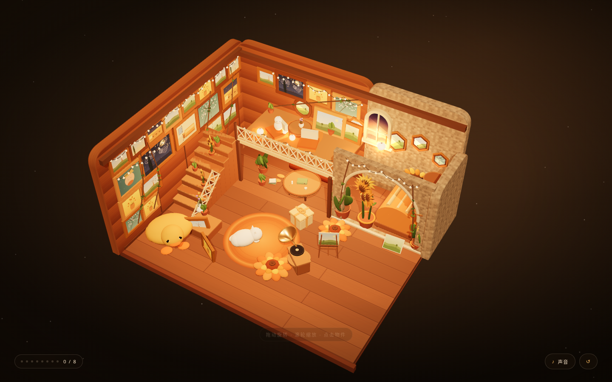

# 星光阁楼 · Starlight Attic

一个**完全离线、零外部素材**的 3D 可交互阁楼网站。整页只有一块全屏 3D 舞台（没有顶部文字栏、没有左右分栏），用 [three.js](https://threejs.org/) 程序化生成全部几何体与贴图。场景按一组参考照片的空间关系复刻：左侧满墙油画画廊、后右角奶白石块拱龛（壁龛 + 拱窗 + 向日葵床 + 画架）、贴左墙而上的交叉格栅楼梯、中段悬挑阁楼，以及橙色沙发、唱片机、白猫、巨型橙绒玩偶等软装。可旋转 / 缩放，点击 8 个物件解锁文案，集齐触发终章。

## 在线预览

部署在 GitHub Pages，仓库根目录即站点入口：
<https://yw-iris.github.io/starlight-cabin/>



## 本地运行

直接用浏览器打开 `index.html` 即可，无需联网、无需构建。

```bash
# 任选其一
open index.html                 # macOS
xdg-open index.html             # Linux
start index.html                # Windows
```

## 文件结构

| 文件 | 作用 |
| --- | --- |
| `index.html` | 页面入口（全屏 3D 舞台 + 浮动 HUD） |
| `app.js` | 场景、建模、灯光、交互、WebAudio 实时音效 |
| `styles.css` | 暖琥珀主题、玻璃质感 HUD、响应式 |
| `vendor/three.min.js` | 本地内置 three.js r0.149 |

## 内饰要点

- **房间**：12.6 × 10.4 × 6.2 的暖光阁楼，深色斜顶 + 墙裙与顶梁
- **左墙·画廊**：整面木板墙上约 20 幅**厚暖木框**（`ExtrudeGeometry` 斜切倒角，三档木色随机轮换 + 深色内衬阴影缝）油画，3 行密排 + 落地倚墙画；画心为程序化的梵高经典（星月夜 / 向日葵 / 自画像 / 阿尔勒卧室 / 麦田群鸦 / 杏花 / 风车 / 黄房子），带 `emissiveMap` 微自发光，暗处也有内透感
- **后墙与阁楼背墙**：木板 + 奶白石块；阁楼平台上方背墙补满画作与**手工雕刻感的八角木框风景**，配攀爬藤蔓与串灯，避免大片空白
- **坐垫**：两枚**向日葵花瓣坐垫**（双层花瓣 + 蓬松中心 + 棕色纽扣缝线），一枚在前厅地面、一枚在拱龛前的画架旁
- **后墙**：左侧木板 + 右侧奶白石块；右后角是**石拱壁龛**——拱形开口 + 石窗台，龛内嵌 3 个六边形壁龛与一扇拱形窗，摆一架画架与一张向日葵床
- **右墙**：部分石块墙（高至拱龛顶），上挂圆形蘑菇架，摆白瓷娃娃与发光水晶球
- **楼梯**：贴**左墙**而上的 8 级实木踏步，白色交叉格栅护栏 + 起步 / 收头柱，台阶上错落摆陶土向日葵与小盆栽，梯座摆白瓷花 pitcher
- **阁楼**：中段靠后悬挑木平台，前缘双向白色交叉格栅护栏；台上新增**阁楼小角落**——圆矮桌 + 花瓶紫粉小花 + 两把橙垫奶油靠背坐凳 + 白色玩偶 + 盆栽 + 圆形地毯，靠墙斜放画作
- **软装**：橙垫沙发（阁楼下）、圆木桌（书 / 花）、留声机（点击转盘转动、喇叭微抬）、白猫、礼物盒、**画架（移到拱龛前的木地板上，正对镜头 + 旁边倚墙放一块未装框画布）**、地毯、前左**趴地大黄鸭抱枕**
- **光氛围**：暖橙半球光 + 顶光 + 窗光 + 画廊灯 + 阁楼灯 + 拱龛灯 + 角落灯，ACES 色调映射，地板中心一层柔和暖光晕
- **植物**：龟背竹、向日葵、多肉小盆栽、藤蔓串灯、拱窗透光

## 交互

- 拖拽旋转 · 滚轮 / 双指缩放 · 松手后轻微呼吸式漂移
- 点击：沙发、唱片机、小猫、礼盒、窗、书、花、串灯（悬停有高亮与提示）
- 集齐 8/8 触发终章，可重玩
- 右下角可静音 / 重置视角

## 技术说明

- three.js r0.149（UMD，本地引入，离线可用）
- 关闭 `ColorManagement.legacyMode`，十六进制颜色按 sRGB 解释后转线性，避免整体发灰发白
- `MeshStandardMaterial` + `PMREMGenerator` 环境贴图 + ACES 色调映射 + `PCFSoftShadowMap`
- `CanvasTexture` 程序化生成木纹 / 石纹 / 地板 / 地毯 / 夜空 / 10 种手绘油画
- `ExtrudeGeometry` 圆角体、拱形墙、六边形壁龛、**斜切倒角厚木画框与雕刻感八角框**；`LatheGeometry` 做留声机喇叭与花器
- `InstancedMesh` 花丛与灯泡、`Sprite` 光晕、`Points` 星空与浮尘
- WebAudio API 实时合成氛围 pad、拨弦、铃音、翻页声与猫呼噜

> 内饰参考了一组《光·遇》风格的阁楼截图：暖橙木墙、厚橙画框、交叉格栅、串灯藤蔓与向日葵。
